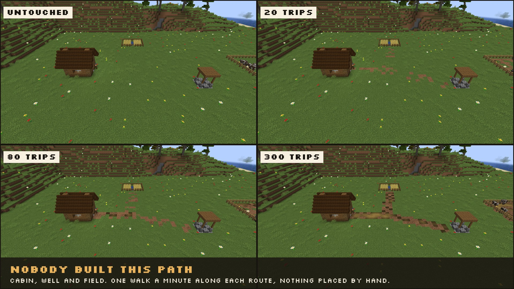
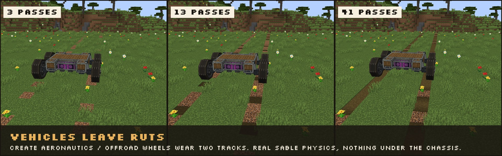
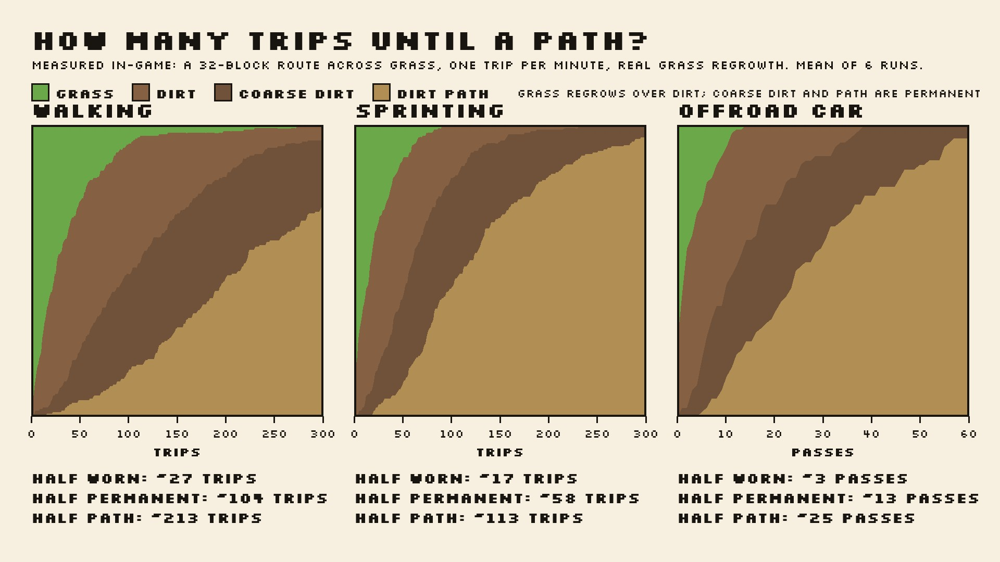
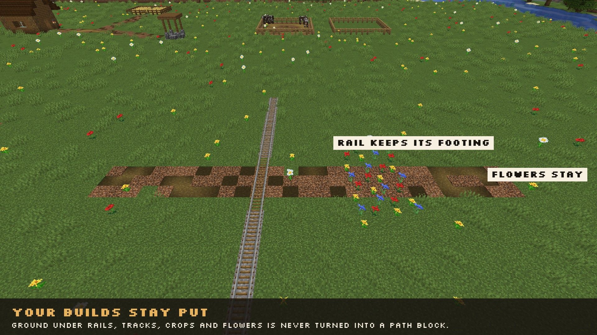

# Worn Ground

Walk the same way often enough and the ground remembers. Players and animals slowly wear **desire paths** into the world, using only vanilla blocks:

**grass → dirt → coarse dirt → dirt path**

Inspired by [TFC Desire Paths](https://modrinth.com/mod/tfc-desire-paths), built for non-TFC NeoForge packs — in particular Create-style engineering packs.

<p align="center"></p>

## How it works

- Every time a player or animal steps onto a new block, there is a small chance the block wears one stage.
- Grass grows back over plain dirt by itself, so a route only turns into a lasting path if it keeps being used. Coarse dirt and paths stay until you dig or hoe them.
- **Sprinting** wears the ground twice as fast. **Sneaking** leaves no trace, and neither do **leather boots**.
- Tall grass and ferns are trampled before the ground below them wears.
- Livestock, horses, villagers, golems and other heavy mobs make paths too (at a quarter of the player rate), so pens and village routes get worn in over time. Respects the `mobGriefing` game rule.
- **Vehicles leave ruts**: with [Sable](https://modrinth.com/mod/sable) installed, the wheels of [Create Aeronautics](https://modrinth.com/mod/create-aeronautics) / Offroad vehicles wear two tracks, and hulls or sleds wear whatever they are dragged across.
- Podzol and mycelium wear to dirt as well.

<p align="center"></p>

## How long does it take?

Measured in-game with the default config on a 32-block route across grass, with real grass regrowth running (average of 6 runs):

| Traffic | Half the route worn | Half permanent (coarse dirt or path) | Half dirt path |
| --- | --- | --- | --- |
| Walking | ~27 trips | ~104 trips | ~213 trips |
| Sprinting | ~17 trips | ~58 trips | ~113 trips |
| Offroad car | ~3 passes | ~13 passes | ~25 passes |
| 4 cows in a 9×9 pen | ~1.5 days | ~5 days | ~11 days |

- How often you walk a route hardly matters between "back and forth" and "every 5 minutes": the count of trips is what makes the path.
- A route walked only **once a day** stays a faint trail: after 100 days it is still mostly plain dirt and grass, because the grass keeps growing back.
- A single crossing leaves at most a few dirt patches that regrow.

<p align="center"></p>

Too fast or too slow for your pack? `chanceMultiplier` scales everything.

## Plays nice with the rest of your pack

- **Never removes support**: ground under rails, Create tracks, machines, crops, flowers or anything else is only swapped for another full, plant-friendly block — a path block only ever forms under open air.
- **[Sable](https://modrinth.com/mod/sable) / [Create Aeronautics](https://modrinth.com/mod/create-aeronautics)**: vehicles wear the ground they drive on, while decks and gardens *on* airships and other physics contraptions are left untouched by default (`wearOnContraptions`).
- **[Dynamic Trees](https://modrinth.com/mod/dynamictrees)**: root soil blocks are never touched.
- **Farmland** keeps its vanilla trampling behaviour.
- **[Block Runner](https://modrinth.com/mod/block-runner)**: worn-in paths are real dirt path blocks, so they get its speed boost.
- Server-side: only the server (or the single-player world) needs the mod.

<p align="center"></p>

## Configuration

`config/worn_ground-common.toml`: toggle players / mobs / vehicles, global chance multiplier, sprint, mob and vehicle multipliers, sneaking, trampling, `mobGriefing`, wear on contraption decks.

## Datapacks

Everything is data-driven.

**Wear rules** are a block [data map](https://docs.neoforged.net/docs/1.21.1/resources/server/datamaps/) at `data/worn_ground/data_maps/block/wear.json`:

```json
{
  "values": {
    "minecraft:grass_block": { "result": "minecraft:dirt", "chance": 0.06 },
    "minecraft:dirt": [
      { "result": "minecraft:mud", "chance": 0.05, "weather": "rain" },
      { "result": "minecraft:coarse_dirt", "chance": 0.03 }
    ],
    "minecraft:coarse_dirt": { "result": "minecraft:dirt_path", "chance": 0.02 }
  }
}
```

`chance` is per step onto the block (0–1). `weather` is `any` (default), `rain` or `clear`. A block may have one rule or a list; the first rule that succeeds wins. Use `"replace": true` or `"remove": [...]` to drop the defaults.

**Tags**

| Tag | Purpose |
| --- | --- |
| `worn_ground:path_makers` (entity type) | Mobs that wear the ground. Players always do. |
| `worn_ground:trampleable` (block) | Plants that are flattened before the ground wears. |
| `worn_ground:soft_soles` (item) | Boots that prevent wear. |
| `worn_ground:wheels` (block) | Blocks whose tire touches the ground beside them (Offroad wheel mounts). |
